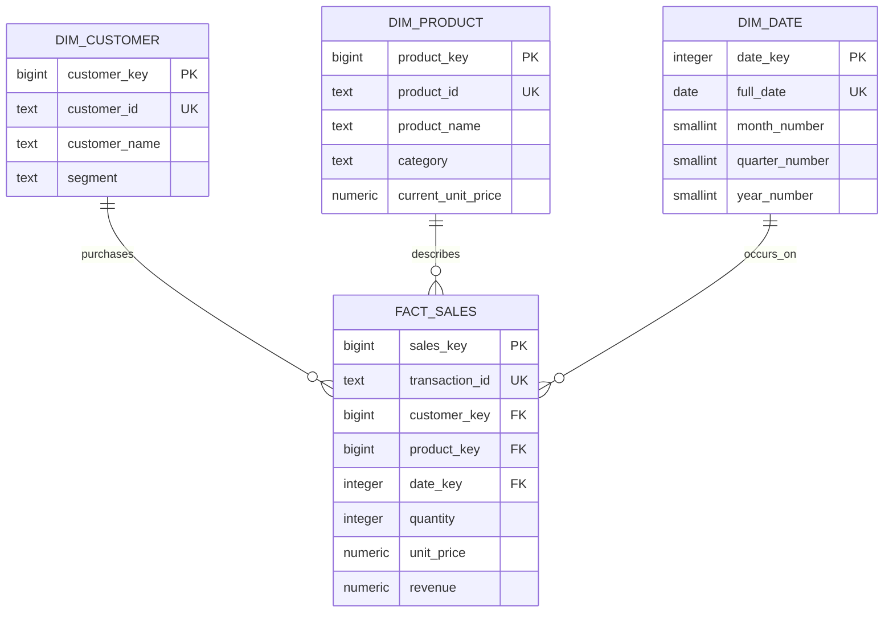

# Entity relationship diagram

`fact_sales` has one row per source transaction line item. Its price is stored at transaction time; the product dimension's current price is descriptive and can change independently.

